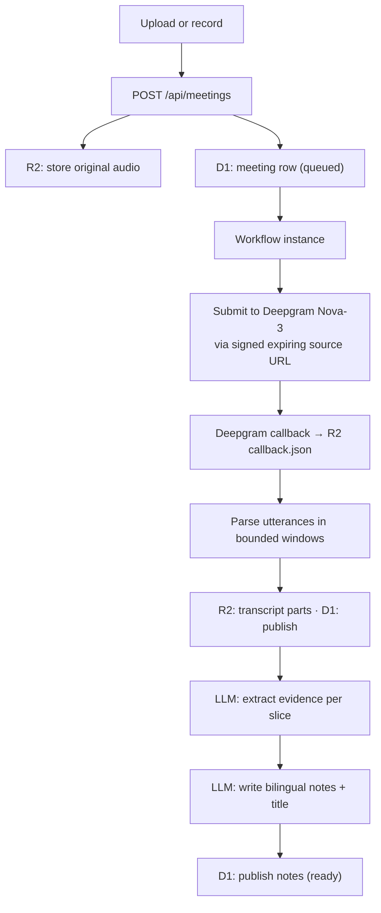
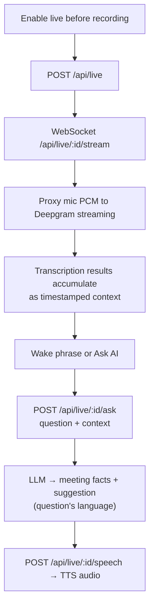

# Meeting Assistant

Record or upload a conversation and get a speaker-labeled transcript alongside editable meeting notes in Simplified Chinese and English. One access code opens the same workspace on another device — including saved notes, the transcript, and the original audio — with no registration or login.

The application runs entirely on Cloudflare: a static frontend, a Worker for backend compute, D1 for relational state, R2 for audio and transcript objects, and Cloudflare Workflows for background processing. Speech comes from Deepgram; bilingual notes, translations, titles, and live answers come from a language model.

[Product specification](SPEC.md) · [Assignment](ASSIGNMENT.md) · [Submission guide](SUBMISSION.md) · [中文](README.zh-CN.md)

## Features

### Core

- **Audio input** — upload a file (MP3/WAV/M4A/OGG/WebM, up to 95 MB) or record from the microphone. Transcription runs after recording stops.
- **Speaker-labeled transcript** — Mandarin, English, and mixed speech are recognized; speakers are distinguished (“Speaker 1”, “Speaker 2”, …) with per-utterance timestamps, paged loading, and range playback/seek against the original audio.
- **Bilingual notes** — a brief summary, main discussion topics, confirmed decisions, action items (task/owner/deadline only when stated), and open questions, generated in both Simplified Chinese and English. Unsupported content is omitted rather than invented.
- **Edit with sync** — editing either language automatically updates the other; concurrent edits on another device are detected instead of silently overwritten.
- **Bilingual UI** — switch between English and Chinese at any time; both note versions remain available regardless of the selected language.
- **Access codes & history** — one access code represents one workspace. Reopening it on another device retrieves that workspace’s full meeting history.
- **Titles & deletion** — manual or AI-generated titles; a confirmed deletion hides the meeting immediately and starts idempotent cleanup of its audio, transcript, and notes.

### Bonus: real-time AI assistance

During a microphone recording, ask questions or request ideas from an assistant grounded in **what has already been discussed in the current meeting**:

- A spoken wake phrase (“Hey meeting assistant” / “你好，会议助手”) or an **Ask AI** button starts a question.
- Replies appear as visible text **and** spoken audio, generated in the language of the question.
- Answers separate confirmed meeting facts from AI suggestions.

## Architecture

### Cloudflare services

| Service | Responsibility |
| --- | --- |
| **Workers Static Assets + Worker** | Serve the single-page UI and the same-origin `/api` backend. Handle sessions, ownership checks, streaming uploads, byte-range audio playback, and edits. |
| **D1** | Source of truth for workspaces, sessions, meeting state, note revisions, titles, and live-session counters. A version check prevents simultaneous edits from overwriting each other. |
| **R2** (private) | Store original audio, Deepgram callbacks, and paged transcript utterances. A job-scoped, expiring, signed URL gives Deepgram temporary read access to its input audio. |
| **Cloudflare Workflows** | Run the transcription pipeline (submit → await callback → normalize → generate notes) and the deletion cleanup, with retries and durable steps. |
| **Deepgram Nova-3** | Batch transcription with multilingual recognition and diarization, delivered via webhook rather than streaming, so the Worker never decodes the long audio itself. |
| **Deepgram streaming + Flux TTS** | The live assistant’s real-time transcription and spoken replies (`flux-lijuan-zh` / `flux-alexis-en`). |
| **External LLM or Workers AI** | Extract evidence from long transcripts, combine it into aligned bilingual notes, translate edits, suggest titles, and answer live questions. |

### Code layout

```
├── src/                  # Browser frontend (vanilla TypeScript + Vite)
│   ├── main.ts           # App shell: workspace, meetings, upload/record, notes, titles, delete
│   ├── live.ts           # LiveAssistant: live WebSocket, wake phrase, ask + TTS
│   ├── live-turns.ts     # Turn assembly, wake-phrase parsing, live context accumulation
│   ├── strings.ts        # English / Chinese UI strings
│   └── style.css
├── worker/               # Cloudflare Worker backend
│   ├── index.ts          # Routing: session, meetings, upload, playback, notes, title, retry, provider endpoints
│   ├── live.ts           # Live assistance: session, WebSocket proxy, ask, speech
│   ├── workflow.ts       # Workflow entrypoint (MeetingProcessing) + deletion cleanup
│   ├── transcript.ts     # Bounded-window streaming JSON callback parser
│   ├── notes.ts          # LLM calls: evidence extraction, notes, translation, titles
│   ├── deletion.ts       # Meeting deletion cleanup
│   ├── security.ts       # Access codes, session tokens, HMAC job proofs
│   ├── http.ts           # ApiError, JSON helpers, size-limited body parsing
│   └── types.ts          # Env, domain types, storage key helpers
├── shared/live.ts        # Live-assistant limits and reply types shared with the client
├── migrations/           # D1 schema migrations
├── public/live-pcm.js    # AudioWorklet that downsamples mic audio to 16 kHz PCM
├── test/                 # Unit tests (node --test)
├── index.html            # Vite entry
├── wrangler.jsonc        # Bindings, vars, static assets, compatibility
└── package.json
```

### Post-recording pipeline



1. The browser streams the audio to `POST /api/meetings`; the Worker writes it to R2 and inserts a `meetings` row in the `uploading` state.
2. `startJob` creates a Workflow instance and moves the row to `queued`. Retries reuse the same instance.
3. The Workflow moves the row to `transcribing` and submits the audio to Deepgram Nova-3, passing a short-lived, HMAC-signed source URL and a signed callback URL.
4. Deepgram POSTs its result to `POST /api/jobs/:id/:attempt/callback`. The Worker authenticates the request and streams the body straight into R2 (`callback.json`) without loading the whole webhook into memory.
5. The Workflow polls for the callback, then normalizes utterances in bounded read windows (see `worker/transcript.ts`), storing speaker/label/start/end/text segments as paged JSON parts in R2.
6. Segments are grouped into slices; each slice goes to the LLM as compact evidence bullets.
7. The bullets are combined into one aligned bilingual-notes document plus a title; the meeting becomes `ready`.

### Live AI assistance flow



- The browser downsamples microphone audio to 16 kHz PCM in an AudioWorklet and streams it over a WebSocket. The Worker proxies the frames to Deepgram’s streaming endpoint.
- Finalized utterances accumulate client-side into a timestamped context buffer (capped at 48,000 characters, older content truncated).
- A wake phrase or the Ask AI button submits the question **with that context**. The Worker prompts the model to answer only from the transcript, returning `{ language, meeting, suggestion }` plus a signed speech token.
- The Worker generates reply audio from Deepgram Flux TTS in the question’s language. While audio is playing, silence is streamed back instead of the assistant’s own output, so it is not re-transcribed.

### API surface

All paths are under `/api`, same-origin with the frontend.

| Method | Path | Purpose |
| --- | --- | --- |
| GET | `/session` | Session and demo state |
| POST | `/session` | `{action:"create"}` or `{action:"open", code}` |
| DELETE | `/session` | Sign out |
| GET | `/meetings` | List workspace meetings |
| POST | `/meetings?title=…&fallbackTitle=…` | Upload audio (streamed body) |
| GET | `/meetings/:id` | Meeting state, notes, revision, transcript part count, audio metadata |
| POST | `/meetings/:id/retry` | Retry a failed meeting |
| GET / HEAD | `/meetings/:id/audio` | Original audio with byte ranges |
| GET | `/meetings/:id/transcript?part=N` | One page of `{start,end,speaker,text}[]` |
| PUT | `/meetings/:id/notes` | `{language,text,version}` → both notes, or 409 on stale revision |
| PUT | `/meetings/:id/title` | `{title}` or `{mode:"auto",language}` |
| DELETE | `/meetings/:id` | Delete meeting, start cleanup (202) |
| GET / HEAD | `/jobs/:id/:attempt/source` | Expiring, signed audio source for Deepgram |
| POST | `/jobs/:id/:attempt/callback` | Deepgram webhook (HMAC Basic auth) |
| POST | `/live` | Create a bounded live session |
| GET | `/live/:id/stream` | WebSocket upgrade for live PCM + transcription |
| POST | `/live/:id/ask` | `{question, context}` → facts + suggestion + speech token |
| POST | `/live/:id/speech` | Signed TTS for a reply |

### Data model

- **workspaces** — `id`, `code_hash` (unique), `created_at`
- **sessions** — `token_hash`, `workspace_id`, `expires_at`
- **meetings** — `id`, `workspace_id`, `title`, `title_source`, `suggested_title`, `mime`, `size`, `created_at`, `state`, `error`, `attempt`, `transcript_parts`, `duration`, `notes_zh`, `notes_en`, `version`, `deleted_at`
- **live_sessions** — `id`, `workspace_id`, `day`, `expires_at`, `connections`, `questions`, `speeches`
- **meeting_attempts** — `meeting_id`, `attempt` (tracks every processing attempt for cleanup)

Meeting state machine: `uploading → queued → transcribing → writing → ready`, with `failed` reachable from any processing state.

### Security model

- **Access codes** are 20 characters from an unambiguous 32-character alphabet, shown only once at creation, and stored as a SHA-256 hash. One code maps to one workspace.
- **Sessions** use a 256-bit random token stored as a SHA-256 hash, delivered in an `HttpOnly`, `SameSite=Strict` cookie scoped to `/api` and valid for 30 days.
- **Provider access** is authorized by HMAC-SHA256 proofs keyed with `JOB_SECRET`, scoped to the meeting, attempt, action, and expiry. The same mechanism signs live speech tokens.
- **Cross-site protection** — non-GET/HEAD requests must be same-origin (checked via `Origin` / `Sec-Fetch-Site`).
- **Secrets stay out of the browser and the repository** — API keys are Worker secrets, never bundled or committed.

## Model and provider choices

- **Deepgram Nova-3** for batch transcription because it handles Mandarin, English, and mixed speech in one model and includes diarization, so speakers are separated by the provider rather than by decoding or chopping audio at the Worker. Its webhook delivery keeps long recordings off the request path, and its streaming + Flux endpoints let the same provider cover the live assistant’s transcription and TTS.
- **DeepSeek V4.1 Flash** (`deepseek-v4.1-flash`, served by Alibaba DashScope via its OpenAI-compatible endpoint `https://dashscope.aliyuncs.com/compatible-mode/v1`) for bilingual notes, translation, titles, and live answers — chosen for strong Simplified-Chinese/English quality and low cost. When `LLM_BASE_URL`, `LLM_MODEL`, and `LLM_API_KEY` are all unset, the Worker falls back to **Workers AI Qwen 3.8 27B** with no extra configuration.
- Prompts are written to treat transcript text as data, never instructions, and to keep opinions/proposals distinct from confirmed decisions.

## Run locally

Use Node.js 22.12 or newer. From the repository:

```sh
npm ci
npm run dev
```

Open the localhost URL printed by Wrangler (default `http://localhost:8787`). No cloud credentials are required — this exercises the real UI, Worker API, local D1/R2, and Workflow, with example transcripts and note translations. Microphone access requires a secure origin; localhost qualifies.

```sh
npm run check   # TypeScript type check
npm test        # unit tests
npm run build   # production build
```

## Deploy to Cloudflare

1. Log in with `npx wrangler login`. Enable R2 Standard in the dashboard and set up a `workers.dev` subdomain if the account lacks one.
2. Create the resources with `npx wrangler d1 create meeting-assistant` and `npx wrangler r2 bucket create meeting-assistant-media`. Set the printed D1 ID in `wrangler.jsonc`. Use a unique Worker or resource name if any is already taken.
3. Set `vars.PUBLIC_ORIGIN` in `wrangler.jsonc` to the exact deployed HTTPS origin. Keep the R2 bucket private. Use the Workers Free plan for an initial deployment.
4. Apply the migration and deploy, then configure secrets.

```sh
npx wrangler d1 migrations apply DB --remote
npm run deploy
openssl rand -hex 32 | npx wrangler secret put JOB_SECRET
npx wrangler secret put DEEPGRAM_API_KEY
npx wrangler secret put LLM_API_KEY
```

Open the deployed URL, create a workspace, and copy its access code before dismissing it. Upload a short clip first to confirm real transcribed speech. `APP_MODE=demo` is set by the local start script only.

## Configuration reference

### Variables (`wrangler.jsonc` `vars`)

| Variable | Purpose |
| --- | --- |
| `PUBLIC_ORIGIN` | Deployed HTTPS origin, used to build signed provider URLs |
| `LLM_BASE_URL` | External OpenAI-compatible API base URL |
| `LLM_MODEL` | External model name |
| `APP_MODE` | `demo` for the local mock; unset in production |

### Secrets (Worker secrets, never committed)

| Secret | Purpose |
| --- | --- |
| `DEEPGRAM_API_KEY` | Batch transcription, live streaming, and TTS |
| `JOB_SECRET` | HMAC key for provider callbacks and expiring audio URLs |
| `LLM_API_KEY` | External language-model API key (omit to use Workers AI) |

## Verification and limits

- The local demo flow checks browser upload and microphone recording, playback and seeking, workspace reuse in separate browser sessions, workspace isolation, language switching, and version conflicts during edits.
- The deployed Free Worker processed the original 87,300,455-byte [Changelog Interviews #669 MP3](https://cdn.changelog.com/uploads/podcast/669/the-changelog-669.mp3). After upload, the Workflow finished in approximately 5 minutes 34 seconds. All 45 transcript pages were read back, with 1,582 utterances, five diarization labels, and a final utterance ending at 89:58.825. Both note versions and audio range playback were verified. A spot check against the [episode page](https://changelog.com/podcast/669) found that the notes used “Jared” for host Jerod. Speaker labels are model estimates.
- A separate 60-second extract from [Mandarin Monkey #469](https://shows.acast.com/mandarin-monkey-podcast/episodes/469-she-was-heartbroken-real-mandarin-english-conversation) produced a transcript containing both Mandarin and English and notes in both languages. Edits from each language successfully translated and saved to the other on the live Worker.
- Live assistance is capped per session (30 minutes, 50 questions, 50 spoken replies, 10 connections) and per day (50 sessions per workspace, 200 per deployment). Live transcript context is capped at 48,000 characters. The limits are defined in `worker/live.ts` and `shared/live.ts`.
- The local mode does not measure Cloudflare Free CPU limits or validate provider output. Validate both after configuring live credentials. Files above the 95 MB application limit must be compressed before uploading.
- An access code grants access to the corresponding history. Store it securely and share it only with intended reviewers. The app does not offer access-code recovery. Before general use, configure account-side provider quotas and a storage retention policy.

## Known tradeoffs

- **Access code = credential.** There is no password reset or recovery; the code is the only way back into a workspace.
- **Live assistance is microphone-only** and must be enabled before recording begins; it does not apply to uploaded files.
- **Speaker labels are diarization estimates**, not verified identities.
- **Notes are generated from the transcript**, so accuracy is bounded by transcription quality; prompts deliberately omit unsupported fields rather than guess.
- **Live answers are grounded in the live streaming transcript**, which may differ slightly from the final batch transcript and is truncated for very long meetings.
