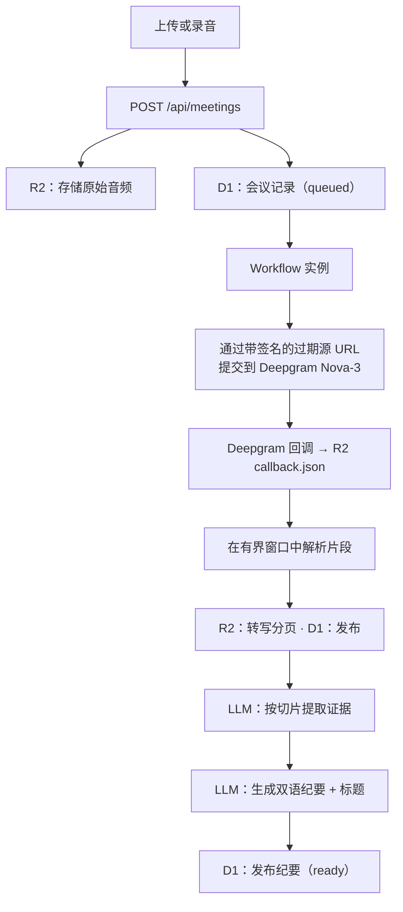
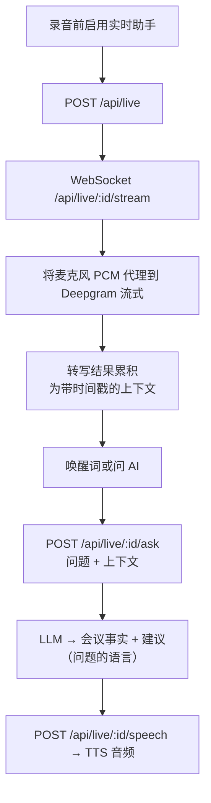

# 会议助手（Meeting Assistant）

上传或录制一段对话，即可获得带说话人区分的转写，以及可编辑的中英文会议纪要。一个访问码即可在另一台设备上打开同一工作区——包括已保存的纪要、转写和原始音频——无需注册或登录。

应用完全运行在 Cloudflare 上：静态前端、负责后端计算的 Worker、负责关系型数据的 D1、负责音频与转写对象的 R2，以及负责后台处理的 Cloudflare Workflows。语音来自 Deepgram；双语纪要、翻译、标题和实时回答来自语言模型（阿里百炼 DeepSeek）。

[English](README.md) · [产品规格](SPEC.md) · [作业要求](ASSIGNMENT.md) · [提交指南](SUBMISSION.md)

## 功能

### 核心功能

- **音频输入** — 上传文件（MP3/WAV/M4A/OGG/WebM，最大 95 MB）或通过麦克风录音。录音结束后自动开始转写。
- **带说话人区分的转写** — 支持普通话、英语和混合语音；区分说话人（"Speaker 1"、"Speaker 2"……），每句话带时间戳，分页加载，并可基于原始音频做区间播放/跳转。
- **双语纪要** — 简明摘要、主要讨论主题、已确认的决定、行动项（仅在明确提到任务/负责人/截止时间时写入）以及待解决问题，同时生成简体中文和英文两个版本。不支持的内容会被省略，而不是凭空编造。
- **编辑并同步** — 编辑任一语言版本会自动更新另一个版本；另一台设备上的并发编辑会被检测到，而不是被静默覆盖。
- **双语界面** — 可随时在中英文之间切换；无论选择哪种语言，两个语言版本的纪要都始终保留。
- **访问码与历史** — 一个访问码对应一个工作区。在另一台设备上重新输入即可取回该工作区的全部会议历史。
- **标题与删除** — 手动或 AI 生成标题；确认删除后立即隐藏会议，并启动幂等的音频、转写与纪要清理。

### 加分项：实时 AI 协助

在麦克风录音期间，可以向一个**基于当前会议已讨论内容**的助手提问或征求想法：

- 说出唤醒短语（"Hey meeting assistant" / "你好，会议助手"）或点击 **问 AI** 按钮开始提问。
- 回复以可见文字**和**语音两种方式返回，语言与问题一致。
- 回答将已确认的会议事实与 AI 建议区分开。

## 架构

### Cloudflare 服务

| 服务 | 职责 |
| --- | --- |
| **Workers 静态资源 + Worker** | 托管单页前端以及同源的 `/api` 后端。处理会话、所有权校验、流式上传、按字节范围的音频播放和编辑。 |
| **D1** | 工作区、会话、会议状态、纪要版本、标题和实时会话计数的事实来源。版本检查防止并发编辑互相覆盖。 |
| **R2**（私有） | 存储原始音频、Deepgram 回调和分页的转写片段。一个按任务限定、带过期时间的签名 URL 给 Deepgram 提供对输入音频的临时读取权限。 |
| **Cloudflare Workflows** | 运行转写流水线（提交 → 等待回调 → 归一化 → 生成纪要）和删除清理，带重试和持久化步骤。 |
| **Deepgram Nova-3** | 批量转写，支持多语言识别和说话人分离，通过 webhook 而非流式方式交付，因此 Worker 本身不解码长音频。 |
| **Deepgram 流式 + Flux TTS** | 实时助手的实时转写和语音回复（`flux-lijuan-zh` / `flux-alexis-en`）。 |
| **外部 LLM 或 Workers AI** | 从长转写中提取证据、合并为对齐的双语纪要、翻译编辑、生成标题，以及回答实时问题。 |

### 代码结构

```
├── src/                  # 浏览器前端（原生 TypeScript + Vite）
│   ├── main.ts           # 应用外壳：工作区、会议、上传/录音、纪要、标题、删除
│   ├── live.ts           # LiveAssistant：实时 WebSocket、唤醒词、提问 + TTS
│   ├── live-turns.ts     # 话轮组装、唤醒词解析、实时上下文累积
│   ├── strings.ts        # 中英文界面文案
│   └── style.css
├── worker/               # Cloudflare Worker 后端
│   ├── index.ts          # 路由：会话、会议、上传、播放、纪要、标题、重试、provider 端点
│   ├── live.ts           # 实时协助：会话、WebSocket 代理、提问、语音
│   ├── workflow.ts       # Workflow 入口（MeetingProcessing）+ 删除清理
│   ├── transcript.ts     # 有界窗口的流式 JSON 回调解析器
│   ├── notes.ts          # LLM 调用：证据提取、纪要、翻译、标题
│   ├── deletion.ts       # 会议删除清理
│   ├── security.ts       # 访问码、会话令牌、HMAC 任务凭证
│   ├── http.ts           # ApiError、JSON 助手、限制大小的请求体解析
│   └── types.ts          # Env、领域类型、存储 key 助手
├── shared/live.ts        # 实时助手限制和与客户端共享的回复类型
├── migrations/           # D1 结构迁移
├── public/live-pcm.js    # 将麦克风音频降采样到 16 kHz PCM 的 AudioWorklet
├── test/                 # 单元测试（node --test）
├── index.html            # Vite 入口
├── wrangler.jsonc        # 绑定、变量、静态资源、兼容性
└── package.json
```

### 录音后处理流水线



1. 浏览器将音频流式发送到 `POST /api/meetings`；Worker 将其写入 R2 并在 `meetings` 表中插入一条 `uploading` 状态的记录。
2. `startJob` 创建一个 Workflow 实例并把记录移到 `queued` 状态。重试复用同一个实例。
3. Workflow 把记录移到 `transcribing` 状态，并把音频提交到 Deepgram Nova-3，传入一个短时、HMAC 签名的源 URL 和一个签名回调 URL。
4. Deepgram 把结果 POST 到 `POST /api/jobs/:id/:attempt/callback`。Worker 校验请求后，将请求体直接流式写入 R2（`callback.json`），而不把整个 webhook 载入内存。
5. Workflow 轮询回调，然后在有界读取窗口中归一化片段（见 `worker/transcript.ts`），把说话人/标签/起止/文本片段作为分页 JSON 存入 R2。
6. 片段被分组为切片；每个切片交给 LLM 生成紧凑的证据要点。
7. 这些要点被合并为一份对齐的双语纪要文档和标题；会议进入 `ready` 状态。

### 实时 AI 协助流程



- 浏览器在一个 AudioWorklet 里把麦克风音频降采样到 16 kHz PCM，并通过 WebSocket 流式发送。Worker 把这些帧代理到 Deepgram 的流式端点。
- 已定稿的片段在客户端累积为带时间戳的上下文缓冲区（上限 48,000 字符，更早的内容被截断）。
- 唤醒词或问 AI 按钮会把问题**连同该上下文**一起提交。Worker 提示模型仅依据转写来回答，返回 `{ language, meeting, suggestion }` 以及一个签名的语音令牌。
- Worker 用 Deepgram Flux TTS 以问题语言生成回复音频。播放期间，会向转写流回传静音，而不是助手自己的输出，以免被再次转写。

### API 接口

所有路径都在 `/api` 下，与前端同源。

| 方法 | 路径 | 用途 |
| --- | --- | --- |
| GET | `/session` | 会话和演示状态 |
| POST | `/session` | `{action:"create"}` 或 `{action:"open", code}` |
| DELETE | `/session` | 退出登录 |
| GET | `/meetings` | 列出工作区的会议 |
| POST | `/meetings?title=…&fallbackTitle=…` | 上传音频（流式请求体） |
| GET | `/meetings/:id` | 会议状态、纪要、版本、转写页数、音频元数据 |
| POST | `/meetings/:id/retry` | 重试失败的会议 |
| GET / HEAD | `/meetings/:id/audio` | 带字节范围的原始音频 |
| GET | `/meetings/:id/transcript?part=N` | 一页 `{start,end,speaker,text}[]` |
| PUT | `/meetings/:id/notes` | `{language,text,version}` → 两份纪要，或版本过期返回 409 |
| PUT | `/meetings/:id/title` | `{title}` 或 `{mode:"auto",language}` |
| DELETE | `/meetings/:id` | 删除会议，启动清理（202） |
| GET / HEAD | `/jobs/:id/:attempt/source` | 给 Deepgram 的过期签名音频源 |
| POST | `/jobs/:id/:attempt/callback` | Deepgram webhook（HMAC Basic 认证） |
| POST | `/live` | 创建有界实时会话 |
| GET | `/live/:id/stream` | 实时 PCM + 转写的 WebSocket 升级 |
| POST | `/live/:id/ask` | `{question, context}` → 事实 + 建议 + 语音令牌 |
| POST | `/live/:id/speech` | 回复的签名 TTS |

### 数据模型

- **workspaces** — `id`、`code_hash`（唯一）、`created_at`
- **sessions** — `token_hash`、`workspace_id`、`expires_at`
- **meetings** — `id`、`workspace_id`、`title`、`title_source`、`suggested_title`、`mime`、`size`、`created_at`、`state`、`error`、`attempt`、`transcript_parts`、`duration`、`notes_zh`、`notes_en`、`version`、`deleted_at`
- **live_sessions** — `id`、`workspace_id`、`day`、`expires_at`、`connections`、`questions`、`speeches`
- **meeting_attempts** — `meeting_id`、`attempt`（跟踪每次处理尝试以便清理）

会议状态机：`uploading → queued → transcribing → writing → ready`，任何处理状态都可能进入 `failed`。

### 安全模型

- **访问码** 由 32 个无歧义字符的字母表中的 20 个字符组成，仅在创建时显示一次，并以 SHA-256 哈希存储。一个访问码对应一个工作区。
- **会话** 使用 256 位随机令牌，以 SHA-256 哈希存储，通过一个 `HttpOnly`、`SameSite=Strict`、作用域为 `/api`、有效期 30 天的 cookie 下发。
- **Provider 访问** 由以 `JOB_SECRET` 为密钥的 HMAC-SHA256 凭证授权，限定于会议、尝试、动作和过期时间。同一机制也为实时语音令牌签名。
- **跨站防护** — 非 GET/HEAD 请求必须同源（通过 `Origin` / `Sec-Fetch-Site` 校验）。
- **密钥不进浏览器、不进代码仓库** — API key 是 Worker secret，永不打包或提交。

## 模型与 provider 选择

- **Deepgram Nova-3** 用于批量转写，因为它在一个模型里同时处理普通话、英语和混合语音，并自带说话人分离，说话人由 provider 区分，而不是在 Worker 端解码或切分音频。它的 webhook 交付让长录音不阻塞请求路径，而其流式 + Flux 端点让同一个 provider 同时覆盖实时助手的转写和 TTS。
- **DeepSeek V4.1 Flash**（`deepseek-v4.1-flash`，由阿里百炼 DashScope 通过其 OpenAI 兼容端点 `https://dashscope.aliyuncs.com/compatible-mode/v1` 提供）用于双语纪要、翻译、标题和实时回答——因其简体中文/英文质量强且成本低而选用。当 `LLM_BASE_URL`、`LLM_MODEL`、`LLM_API_KEY` 均未设置时，Worker 无需额外配置即可回退到 **Workers AI Qwen 3.8 27B**。
- 提示词把转写文本当作数据而非指令处理，并把观点/提案与已确认的决定区分开。

## 本地运行

使用 Node.js 22.12 或更新版本。在仓库目录下：

```sh
npm ci
npm run dev
```

打开 Wrangler 打印的 localhost 地址（默认 `http://localhost:8787`）。无需云端凭据——这会运行真实的 UI、Worker API、本地 D1/R2 和 Workflow，带示例转写和纪要翻译。麦克风访问需要安全源；localhost 符合条件。

```sh
npm run check   # TypeScript 类型检查
npm test        # 单元测试
npm run build   # 生产构建
```

## 部署到 Cloudflare

1. 用 `npx wrangler login` 登录。在 dashboard 里启用 R2 Standard，并在账户没有的情况下设置 `workers.dev` 子域。
2. 用 `npx wrangler d1 create meeting-assistant` 和 `npx wrangler r2 bucket create meeting-assistant-media` 创建资源。把打印出的 D1 ID 填到 `wrangler.jsonc`。如果名称已被占用，换一个唯一的 Worker 或资源名。
3. 把 `vars.PUBLIC_ORIGIN` 设置为准确的部署 HTTPS 源。保持 R2 桶为私有。初始部署使用 Workers Free 计划。
4. 应用迁移并部署，然后配置 secrets。

```sh
npx wrangler d1 migrations apply DB --remote
npm run deploy
openssl rand -hex 32 | npx wrangler secret put JOB_SECRET
npx wrangler secret put DEEPGRAM_API_KEY
npx wrangler secret put LLM_API_KEY
```

打开部署后的 URL，创建一个工作区，并在关闭弹窗前复制它的访问码。先上传一段短音频，确认能转写出真实语音。`APP_MODE=demo` 仅由本地启动脚本设置。

## 配置参考

### 变量（`wrangler.jsonc` 的 `vars`）

| 变量 | 用途 |
| --- | --- |
| `PUBLIC_ORIGIN` | 部署的 HTTPS 源，用于构建签名 provider URL |
| `LLM_BASE_URL` | 外部 OpenAI 兼容 API 的基础 URL |
| `LLM_MODEL` | 外部模型名 |
| `APP_MODE` | 本地模拟为 `demo`；生产环境不设置 |

### Secrets（Worker secret，永不提交）

| Secret | 用途 |
| --- | --- |
| `DEEPGRAM_API_KEY` | 批量转写、实时流式和 TTS |
| `JOB_SECRET` | provider 回调和过期音频 URL 的 HMAC 密钥 |
| `LLM_API_KEY` | 外部语言模型 API key（省略则使用 Workers AI） |

## 验证与限制

- 本地演示流程验证了浏览器上传和麦克风录音、播放与跳转、独立浏览器会话中的工作区复用、工作区隔离、语言切换，以及编辑时的版本冲突。
- 部署的 Free Worker 处理了原始的 87,300,455 字节 [Changelog Interviews #669 MP3](https://cdn.changelog.com/uploads/podcast/669/the-changelog-669.mp3)。上传后，Workflow 约 5 分 34 秒完成。回读了全部 45 页转写，共 1,582 个片段、5 个说话人标签，最后一个片段结束于 89:58.825。两份纪要版本和音频区间播放均验证通过。对照[该集页面](https://changelog.com/podcast/669)抽查发现，纪要中把主持人 Jerod 写成了 "Jared"。说话人标签是模型估计值。
- 一段来自 [Mandarin Monkey #469](https://shows.acast.com/mandarin-monkey-podcast/episodes/469-she-was-heartbroken-real-mandarin-english-conversation) 的 60 秒片段生成了同时含普通话和英语的转写，以及两种语言的纪要。在线上 Worker 上验证了从任一语言编辑并成功翻译保存到另一语言。
- 实时协助按会话（30 分钟、50 个问题、50 条语音回复、10 个连接）和按天（每工作区 50 个会话、每部署 200 个）设限。实时转写上下文上限为 48,000 字符。限制定义在 `worker/live.ts` 和 `shared/live.ts`。
- 本地模式不测量 Cloudflare Free 的 CPU 限制，也不校验 provider 输出。配置好实时凭据后请验证这两点。超过 95 MB 应用限制的文件需先压缩再上传。
- 访问码可访问对应历史。请妥善保存，只分享给目标评审者。应用不提供访问码找回。正式使用前，请配置账户侧的 provider 配额和存储保留策略。

## 已知权衡

- **访问码即凭据。** 没有密码重置或找回；访问码是回到工作区的唯一方式。
- **实时协助仅限麦克风**，且必须在录音开始前启用；不适用于上传的文件。
- **说话人标签是说话人分离的估计值**，不是经过验证的身份。
- **纪要根据转写生成**，因此准确性受转写质量限制；提示词刻意省略不支持的内容而不是猜测。
- **实时回答基于实时流式转写**，可能与最终批量转写略有差异，且对超长会议会被截断。
